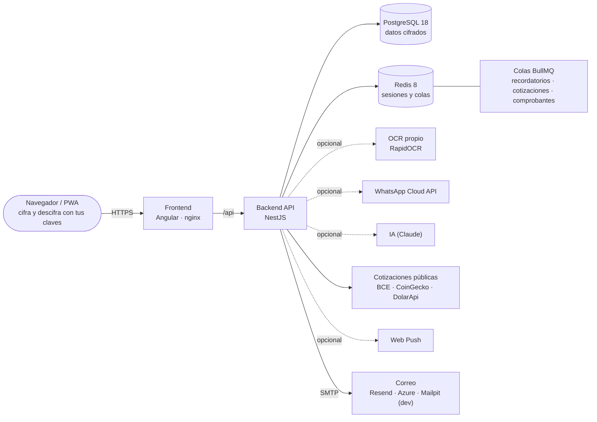

# Commit 🐷

Finanzas personales de 0 a 100, pensadas para **Panamá**: cuentas, movimientos, presupuesto, deudas y tarjetas, ahorro e inversiones, un **Plan mágico** que ordena qué pagar primero, educación financiera y calculadoras públicas.

Los datos financieros se cifran **en tu dispositivo** (conocimiento cero): ni el servidor ni sus administradores pueden leerlos. Ver [docs/arquitectura-cifrado.md](docs/arquitectura-cifrado.md).

## Qué incluye

| Área | Funcionalidades |
|---|---|
| **Día a día** | Cuentas multimoneda (USD por defecto, balboa a la par), movimientos, transferencias, recurrentes, presupuesto 50/30/20 |
| **Deudas y tarjetas** | Préstamos con amortización, pagos con capital/interés, estrategias bola de nieve y avalancha, resúmenes de tarjeta, compras en cuotas |
| **Ahorro e inversión** | Metas, fondo de emergencia, plazos fijos, inversiones y patrimonio neto |
| **Plan mágico** | Qué pagar primero y cuánto ahorrar cada mes, con inflación opcional; calculado en el navegador |
| **Mi progreso** | Puntaje de salud financiera, ruta de 7 niveles y consejos |
| **Facturas por WhatsApp** *(opcional, suscripción)* | Foto → OCR propio → IA → bandeja **Por revisar** con recomendación de cuenta y categoría |
| **Público, sin cuenta** | Landing, **Aprende** (25 artículos) y **Herramientas** (interés compuesto, hipoteca, tarjetas de crédito y débito con tasas de referencia de bancos de Panamá) |
| **Experiencia** | PWA instalable, modo sin conexión (lectura), responsive con barra inferior en el celular, modo claro/oscuro/sistema, hogares compartidos |
| **Cuenta** | Verificación de correo, bienvenida, olvidé mi contraseña, cambiar contraseña y correo, cerrar sesión en todos lados, aviso de ingreso nuevo y eliminar la cuenta |
| **Operación** | Página **/estado** con el diagrama de la infraestructura en vivo |

**Todo es gratis.** Lo único opcional y de pago son las **facturas por WhatsApp** ($2 al mes o $20 al año), porque usan servicios con costo (WhatsApp, OCR e IA). El registro no pide suscripción.

## Arquitectura en una imagen



Más detalle (módulos, flujos y modelo de datos) en [docs/arquitectura.md](docs/arquitectura.md).

## Stack

- `backend/`: NestJS 12 (ESM), Prisma 7, PostgreSQL 18, Redis 8, BullMQ, Zod, `@nestjs/authentication`.
- `frontend/`: Angular 22 (standalone + signals), Angular Material 3, Transloco (español, trato de tú), libsodium.
- `ocr/` *(opcional)*: RapidOCR (modelos de PaddleOCR sobre ONNX Runtime) con FastAPI.
- Pruebas: Vitest (unitarios y e2e de backend) y Playwright (e2e de frontend).

## Levantar

```bash
cp .env.example .env                          # cambiar contraseñas y JWT_SECRET
docker compose --profile dev up --build       # desarrollo: http://localhost:4200
docker compose --profile prod up --build -d   # producción: http://localhost:8080
```

En desarrollo también quedan **Adminer** en http://localhost:8081 (servidor `postgres`), **Mailpit** en http://localhost:8025 (los correos de la app) y la página **/estado**.

### Servicios opcionales

| Servicio | Cómo se activa | Documentación |
|---|---|---|
| OCR propio | `docker compose --profile ocr up -d ocr` y `OCR_URL=http://ocr:8000` | [docs/facturas-whatsapp.md](docs/facturas-whatsapp.md) |
| Facturas por WhatsApp | Credenciales `WHATSAPP_*` de Meta | [docs/facturas-whatsapp.md](docs/facturas-whatsapp.md) |
| Extracción con IA | `ANTHROPIC_API_KEY` | [docs/facturas-whatsapp.md](docs/facturas-whatsapp.md) |
| Notificaciones push | `VAPID_*` | [docs/operacion.md](docs/operacion.md) |
| Correo (Resend, Azure u otro SMTP) | `SMTP_URL`, `MAIL_FROM` | [docs/operacion.md](docs/operacion.md) |

Sin estas variables, cada función queda desactivada y la app lo indica. Todas las variables están descritas en [docs/operacion.md](docs/operacion.md).

## Tests

```bash
cd backend && pnpm typecheck && pnpm lint && pnpm test && pnpm test:e2e   # necesita Postgres y Redis del compose
cd frontend && pnpm ng test && pnpm e2e                                   # e2e: con el stack de desarrollo levantado
```

## Contrato de la API

El backend valida con Zod y publica OpenAPI. Después de cambiar un endpoint:

```bash
cd backend && pnpm openapi          # genera frontend/src/app/core/api/openapi.json (sin base de datos)
cd frontend && pnpm api:types       # regenera los tipos; si un pedido no coincide, no compila
```

## Documentación

| Documento | Contenido |
|---|---|
| [docs/arquitectura.md](docs/arquitectura.md) | Componentes, módulos, flujos principales y modelo de datos |
| [docs/arquitectura-cifrado.md](docs/arquitectura-cifrado.md) | Cifrado de conocimiento cero: claves, payload, recuperación y límites |
| [docs/facturas-whatsapp.md](docs/facturas-whatsapp.md) | Facturas por WhatsApp: configuración en Meta, OCR, IA, privacidad y costos |
| [docs/operacion.md](docs/operacion.md) | Variables de entorno, despliegue, migraciones, estado y mantenimiento de contenidos |
| [docs/despliegue-azure.md](docs/despliegue-azure.md) | Azure Container Apps (staging y producción), dominios, costos y CI/CD con GitHub Actions |

## Licencia

[GNU AGPL-3.0](LICENSE) o posterior. Puedes usar, modificar y redistribuir este software libremente, pero cualquier versión modificada, **incluida una que se ofrezca como servicio web**, tiene que publicar su código fuente bajo la misma licencia.
