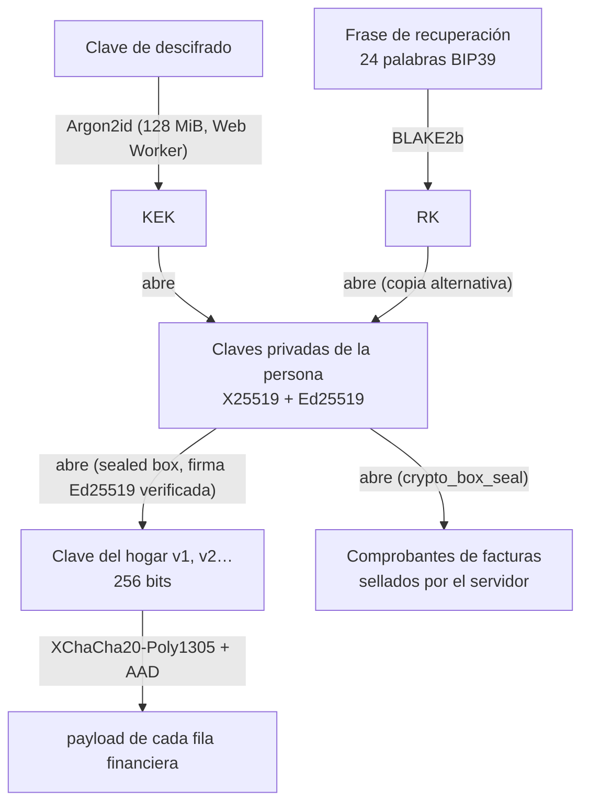
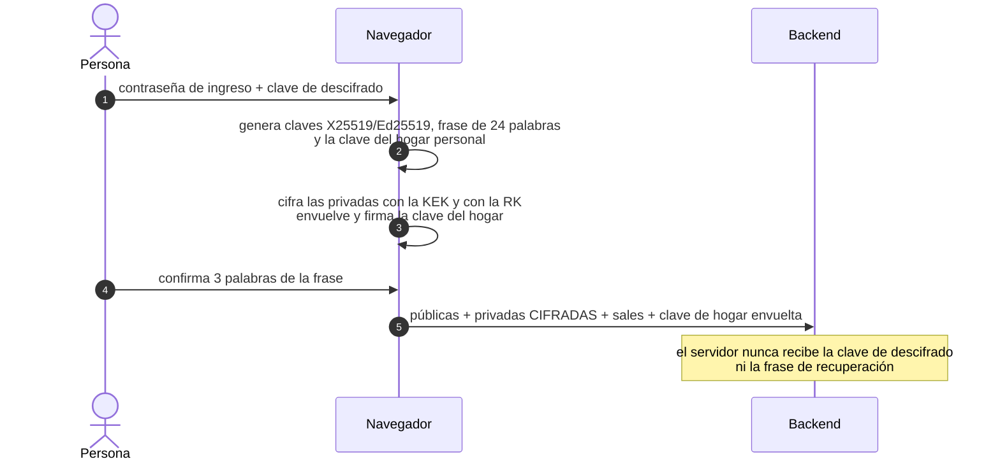

# Arquitectura de cifrado (conocimiento cero, modo híbrido)

Objetivo: que nadie fuera del hogar (ni el administrador, ni el dueño del servidor, ni quien robe la base) pueda leer los datos financieros. El modelo es el de Proton en modo "dos contraseñas".

## Dos secretos por usuario

| Secreto | Dónde se usa | ¿Llega al servidor? |
|---|---|---|
| **Contraseña de login** | Autenticación (`@nestjs/authentication`, scrypt) | Sí, por TLS; se guarda solo su hash |
| **Clave de descifrado** | Deriva la clave que abre las claves privadas del usuario | **Nunca** |
| **Frase de recuperación** (24 palabras, BIP39) | Copia alternativa para abrir las claves privadas | **Nunca**; se muestra una sola vez al registrarse |

## Jerarquía de claves



- Librería: **libsodium** (`libsodium-wrappers-sumo`, carga diferida) en el navegador. Argon2id `crypto_pwhash` (128 MiB, 3 pasadas; el backend exige ≥ 64 MiB), `crypto_box_seal` para envolver claves de hogar, `crypto_sign` para firmar el envoltorio, `crypto_aead_xchacha20poly1305_ietf` para los datos.
- Frase de recuperación: BIP39 en español (`@scure/bip39`, 256 bits). RK = BLAKE2b(entropía, clave = `recoveryKdfSalt`): la frase ya tiene 256 bits, no hace falta un KDF lento. Se aceptan palabras sin tildes.
- Claves privadas cifradas: `boxSecretKey(32) ‖ signSecretKey(64)` con AAD `finanzas:user-keys:v1:passphrase|recovery`. Al abrirlas se verifica que correspondan a las públicas registradas.
- Firma del envoltorio: Ed25519 sobre `"finanzas:member-key:v1:<householdId>:<version>:<userId>:" ‖ wrappedKey` (idéntico en `backend/src/auth/member-key-signature.ts` y `frontend/src/app/core/crypto/member-key.ts`). Si quien envolvió es el propio usuario, el cliente usa su propia clave pública verificada, no la que informa el servidor.
- Los IDs (usuario, hogar, filas) los genera el navegador (UUID v7), porque forman parte del AAD.
- Código: `frontend/src/app/core/crypto/`. Tablas: `user_keys`, `household_keys`, `household_member_keys` (ver `backend/prisma/schema.prisma`).

## Qué queda en claro y qué se cifra (modo híbrido)

- **En claro**: IDs, relaciones (cuenta, categoría, activo), fechas, tipos y estados, moneda, parámetros estructurales (día de cierre, frecuencia, cantidad de cuotas), `revision`/`deletedAt` para sincronizar. El servidor puede filtrar, paginar y sincronizar con esto.
- **Cifrado** (`payload`): montos, tasas, cantidades, precios, nombres, descripciones, notas, puntaje de salud, nivel e hitos.
- **Lo que el servidor puede inferir** (riesgo aceptado del modo híbrido): cuántos movimientos hay y en qué fechas, de qué tipo, en qué categoría (sin su nombre), qué activos del catálogo público tiene un hogar, y las fechas de vencimientos y recordatorios.
- **Datos públicos** (cotizaciones y precios de mercado del catálogo) se guardan en claro: no son del usuario. El servidor los trae cada hora (BullMQ) del Banco Central Europeo (vía Frankfurter, monedas contra el dólar), CoinGecko (cripto) y DolarApi (dólar en Argentina, como referente regional); el balboa se toma a la par del dólar. A ninguna fuente se le envía ningún dato; el navegador descarga las cotizaciones y convierte localmente. Las cotizaciones propias de un hogar van cifradas y tienen prioridad. La preferencia de tipo de dólar del hogar (`usdRateType`) está en claro: es una preferencia, no un dato financiero.

## Formato del payload

```
payload = version(1 byte) ‖ nonce(24 bytes) ‖ ciphertext+tag
AAD     = "<tabla>:<id>:<householdId>:<keyVersion>"
```

El AAD ata el cifrado a su fila: si el servidor intercambia payloads entre filas u hogares, el descifrado falla. El contenido es JSON; los montos van como string decimal (nunca `number`).

## Flujos



**Registro**: el navegador genera las claves, la frase de recuperación y la clave del hogar personal; envía al servidor solo las claves públicas, las privadas cifradas (con la KEK y con la RK), sales y parámetros de KDF, y la clave del hogar envuelta para el propio usuario. El usuario confirma que guardó la frase.

**Ingreso**: login con contraseña (access token de 15 min en memoria; refresh token rotativo en cookie `HttpOnly`, `SameSite=Strict`, `Path=/api/auth`, guardado en Redis) → `GET /api/me` devuelve `user_keys` cifradas → el usuario ingresa su clave de descifrado → el navegador abre las privadas → abre las claves de sus hogares. Las claves se usan en memoria y nunca se guardan en claro. Para que recargar la pestaña no pida la clave, el par de claves se guarda cifrado en la pestaña (ver *Recargar la pestaña*); al bloquear, cerrar sesión o tras inactividad se borra todo.

**Cambiar la clave de descifrado**: se vuelven a cifrar las privadas con una KEK nueva. Los datos no se tocan.

**Invitar a un miembro**: invitación por email → la persona se registra/acepta → queda `PENDING_KEY` → el próximo admin que abra la app verifica la clave pública del invitado (huella visible) y le envuelve la clave del hogar → `ACTIVE`.

**Quitar un miembro**: se crea una versión nueva de la clave del hogar, envuelta para los que quedan. Lo nuevo se cifra con la versión nueva; lo ya cifrado puede re-cifrarse en segundo plano desde el navegador. (Lo que el ex-miembro ya descargó, inevitablemente, lo conserva.)

**Recuperación**:
1. Con la frase de recuperación: abre las privadas y define una clave de descifrado nueva. No se pierde nada.
2. Sin clave ni frase: el usuario resetea sus claves (`keyVersion + 1`). Sus membresías pasan a `PENDING_KEY` y otro miembro ACTIVE (OWNER/ADMIN) del hogar le vuelve a compartir la clave. **Los hogares donde era el único miembro (incluido el personal) se pierden**: nadie más tenía la clave.

**Contraseña de ingreso olvidada**: se restablece con un enlace por correo (1 h, un solo uso) y se cierran todas las sesiones. No afecta los datos: siguen cifrados con la clave de descifrado, que nunca pasa por el servidor. Por eso ningún correo puede devolver el acceso a los datos; para eso existe la frase de recuperación.

**Eliminar la cuenta**: se borra todo lo personal (hogares donde la persona es el único miembro, suscripción, WhatsApp, notificaciones). Si comparte hogares, los datos del hogar quedan para los demás miembros y la cuenta se **anonimiza**: sin correo, nombre, contraseña ni claves privadas cifradas. Se conserva solo su clave pública, porque los demás la necesitan para verificar la firma de las claves del hogar que ella les envolvió.

## Caché offline

Las respuestas de la API se guardan en IndexedDB **tal como llegan, es decir, cifradas**, y se descifran en memoria tras ingresar la clave. Sin conexión, la app abre lo guardado en **modo solo lectura** (lo que se intente guardar sin conexión falla con un aviso; no se encola).

Los movimientos se sincronizan de forma incremental con `GET .../transactions?since=<revision>` y lápidas (`deletedAt`). Como una `revision` de secuencia puede hacerse visible fuera de orden entre transacciones concurrentes, el servidor informa la primera revisión "reciente" de cada página y el cliente no avanza su cursor guardado más allá de ella: esas filas se vuelven a pedir la próxima vez.

La caché se borra al iniciar y al cerrar sesión. Una respuesta pedida antes de cerrar sesión que llega después se descarta (no vuelve a escribir en el dispositivo).

## Recargar la pestaña (F5)

Para no pedir la clave de descifrado en cada recarga, al desbloquear se guarda **solo el par de claves de la persona**, cifrado con AES-GCM usando una llave de WebCrypto **no exportable** (en IndexedDB). El texto cifrado va a `sessionStorage`, que pertenece a esa pestaña y se borra al cerrarla. Al recargar se descifra y se vuelven a abrir y verificar las claves de los hogares (con datos frescos del servidor).

- Se borra al **bloquear**, al **cerrar sesión** y por **inactividad**. Si el tiempo de bloqueo automático pasó desde la última actividad, no se restaura.
- Otra pestaña, una ventana nueva o el navegador reabierto **piden la clave**.
- Límite: un script malicioso ejecutándose en el sitio podría usar esa llave mientras la pestaña está abierta, igual que podría leer las claves de la memoria. No agrega exposición frente a quien no tiene acceso al navegador desbloqueado.

## Recordatorios

El navegador agenda `reminders` con `remindAt` en claro y el texto cifrado. Un job de BullMQ crea, a esa hora, una `notification` por miembro activo con el mismo payload cifrado. El servidor conoce cuándo, no qué ni cuánto.

**Web Push** (implementado): con la app cerrada, el servidor envía una notificación push genérica ("Tienes un recordatorio"), sin datos financieros; el detalle se descifra al abrir la app. Un job de BullMQ revisa cada minuto los recordatorios vencidos y los reclama con `FOR UPDATE SKIP LOCKED` (nunca se disparan dos veces). El navegador programa los recordatorios de los próximos 35 días (vencimientos de tarjeta, cuotas, plazos fijos y recurrentes a confirmar) sin duplicarlos.

## Excepción: facturas por WhatsApp

Es la única función donde un dato del usuario se procesa en el servidor, y es **opcional, con consentimiento explícito**:

- La foto la ven **Meta** (es su plataforma) y nuestro **servidor**, que la procesa en memoria y la **descarta**.
- Con el OCR propio, a la **IA le llega solo el texto**, no la foto.
- El resultado se guarda **sellado** (`crypto_box_seal`) con la clave pública X25519 de la persona: desde ese momento, ni el servidor puede leerlo. Solo la clave privada, en el navegador, lo abre.
- Del número de WhatsApp se guarda solo un **HMAC**; la vinculación usa un código de un solo uso.
- La recomendación de cuenta y categoría se calcula en el navegador.

Detalle completo en [facturas-whatsapp.md](facturas-whatsapp.md).

## Lo que el cifrado NO protege

- **Código del cliente**: el servidor entrega el JavaScript que cifra. Un servidor comprometido podría servir código malicioso. Mitigaciones: CSP estricta, Subresource Integrity, builds reproducibles y, a futuro, app de escritorio/móvil firmada.
- **Metadatos** listados arriba (modo híbrido).
- **Dispositivo comprometido**: con malware en el equipo del usuario, nada de esto alcanza.

Como segunda capa, el disco del servidor de producción debe estar cifrado (configuración del hosting).
