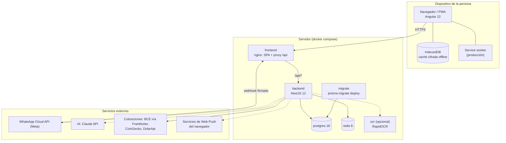
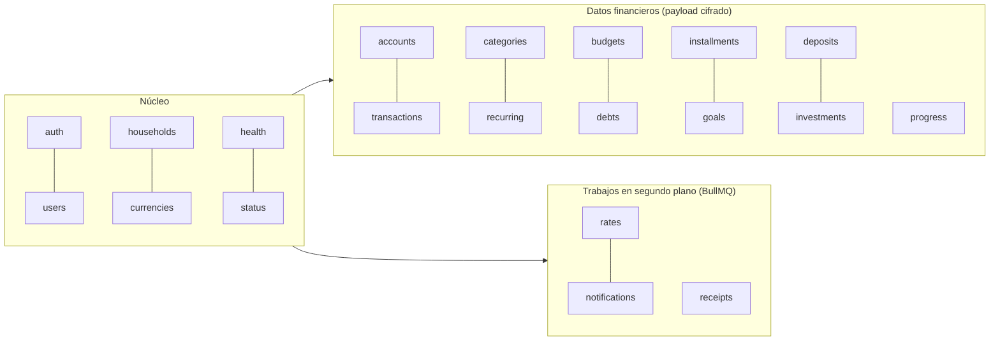
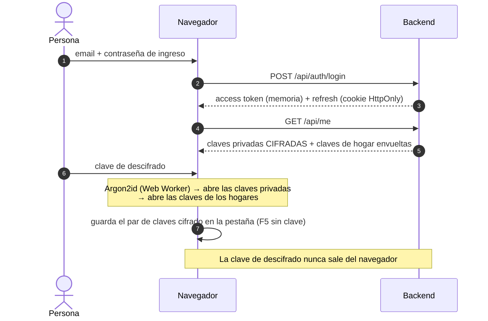
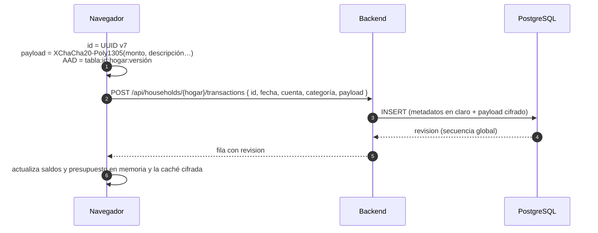
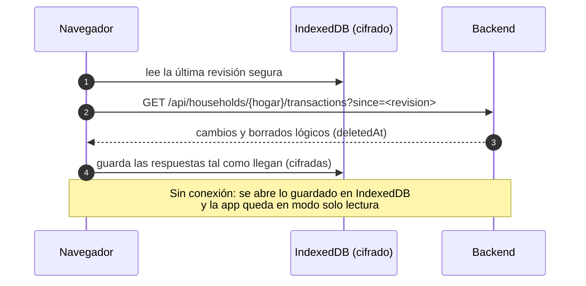
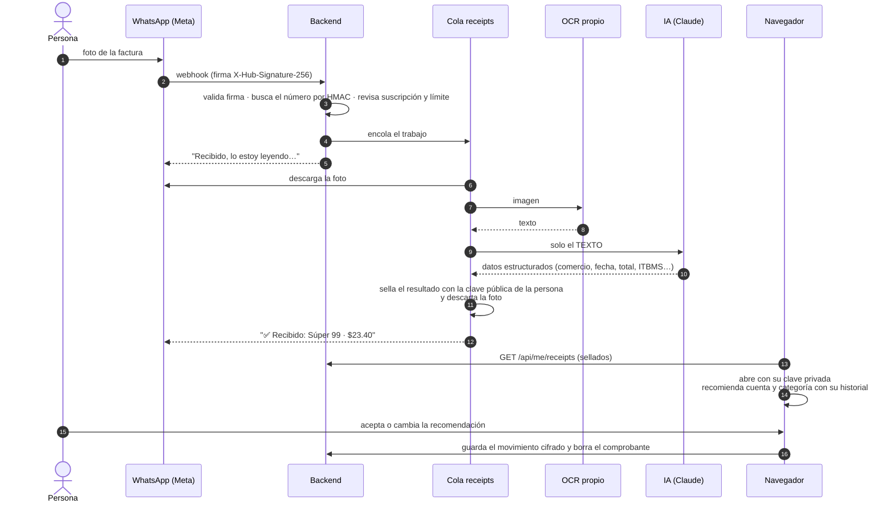
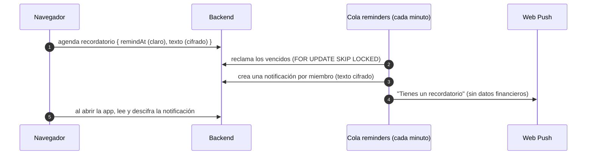
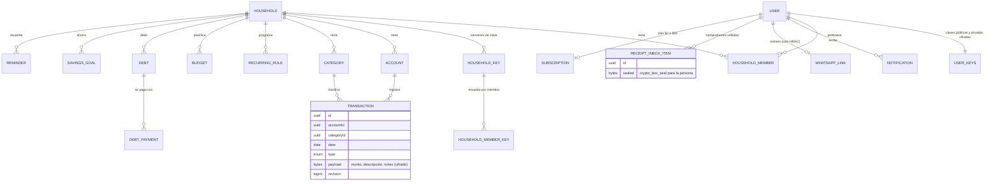

# Arquitectura

Visión general de cómo está armado Commit: componentes, módulos, flujos principales y modelo de datos. El detalle criptográfico está en [arquitectura-cifrado.md](arquitectura-cifrado.md).

> Principio rector: **el servidor guarda y sincroniza datos cifrados, el navegador calcula**. Saldos, presupuestos, el Plan mágico, el puntaje de progreso y las recomendaciones de facturas se calculan en el cliente, con los datos ya descifrados.

## Componentes y despliegue

| Servicio compose | Perfil | Función |
|---|---|---|
| `postgres`, `redis` | siempre | Datos (cifrados) y sesiones, códigos temporales y colas |
| `backend-dev`, `frontend-dev`, `adminer` | `dev` | Desarrollo con recarga en caliente (http://localhost:4200) |
| `migrate`, `backend`, `frontend` | `prod` | Producción: migraciones, API y nginx (http://localhost:8080) |
| `ocr` | `ocr` | OCR propio para facturas, opcional |

## Backend: módulos

| Módulo | Responsabilidad |
|---|---|
| `auth`, `users` | Registro, login (scrypt), access token en memoria + refresh rotativo en cookie, claves públicas y privadas **cifradas** |
| `households` | Hogares, miembros, roles, invitaciones y envoltorios de la clave del hogar |
| `accounts` … `investments` | CRUD de filas con metadatos en claro y `payload` cifrado; sincronización por `revision` |
| `rates` | Cotizaciones públicas cada hora (cola `rates`) |
| `notifications` | Recordatorios cifrados, notificaciones y Web Push (cola `reminders`, cada minuto) |
| `receipts` | Facturas por WhatsApp: webhook, vinculación, OCR + IA y bandeja **sellada** (cola `receipts`) |
| `status` | Estado en vivo de la infraestructura para `/estado` |

## Frontend: áreas

| Ruta | Acceso | Qué hace |
|---|---|---|
| `/`, `/aprende`, `/herramientas` | Público | Landing, artículos y calculadoras |
| `/registro`, `/ingresar`, `/desbloquear`, `/recuperar` | Sesión | Cuenta, clave de descifrado y frase de recuperación |
| `/inicio`, `/movimientos`, `/presupuesto`, `/deudas`, `/ahorro`, `/cuentas`, `/recurrentes` | Desbloqueado | Finanzas del hogar |
| `/plan`, `/progreso` | Desbloqueado | Plan mágico y salud financiera |
| `/por-revisar`, `/suscripcion` | Desbloqueado | Facturas recibidas y planes |
| `/ajustes`, `/hogar`, `/cotizaciones` | Desbloqueado | Preferencias, WhatsApp, apariencia, miembros y monedas |
| `/estado` | Desarrollo o token de operador | Diagrama de infraestructura en vivo |

## Flujos principales

### Ingreso y desbloqueo

### Guardar un movimiento

### Sincronización y modo sin conexión

### Factura por WhatsApp

Más detalle en [facturas-whatsapp.md](facturas-whatsapp.md).

### Recordatorios y Web Push

## Modelo de datos (simplificado)

Toda fila financiera pertenece a un hogar y guarda sus datos sensibles en `payload` (cifrado). Las tablas sincronizables tienen `revision` (asignada por un trigger) y `deletedAt`.

El esquema completo está en [`backend/prisma/schema.prisma`](../backend/prisma/schema.prisma).

## Decisiones clave

| Decisión | Motivo |
|---|---|
| Cálculos en el navegador | El servidor no puede leer montos: saldos, presupuestos, Plan mágico y recomendaciones se calculan con los datos descifrados |
| IDs generados en el cliente (UUID v7) | Forman parte del AAD del cifrado, así que existen antes de enviar la fila |
| Montos como texto decimal | Sin errores de punto flotante (aritmética con BigInt) |
| `revision` global + `deletedAt` | Sincronización incremental y conflictos detectados (409) |
| Colas BullMQ con prefijo por entorno | Los tests no comparten trabajos con el entorno de desarrollo |
| OCR propio antes que la IA | A la IA le llega el texto de la factura, no la foto |
