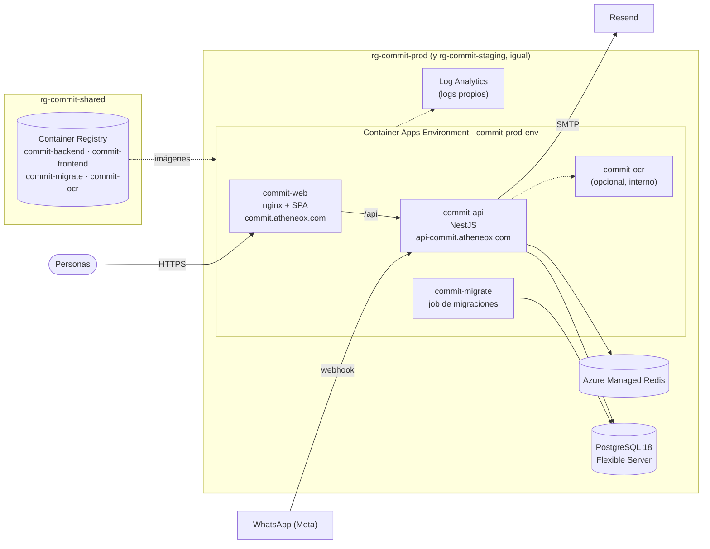
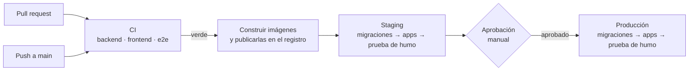

# Despliegue en Azure

Commit corre en **Azure Container Apps** (región **North Central US**), con dos ambientes completos: **staging** y **producción**. La infraestructura está como código (Bicep, en `infra/`) y GitHub Actions despliega solo: CI → staging → aprobación → producción.

## Arquitectura



| Recurso | Nombre | Notas |
|---|---|---|
| Grupos | `rg-commit-shared`, `rg-commit-staging`, `rg-commit-prod` | Región `northcentralus` |
| Registro | `commitacr<sufijo>` | Compartido; las apps leen con identidad administrada (sin contraseñas) |
| Frontend | `commit-web` | nginx; sirve la app y reenvía `/api` al backend |
| Backend | `commit-api` | También expuesto en `api-…` para webhooks (Meta) y `/health`, `/ready` |
| Migraciones | `commit-migrate` (job) | Se ejecuta en cada despliegue, **antes** de actualizar las apps |
| OCR | `commit-ocr` | Opcional (`enableOcr`), escala a 0 |
| Base de datos | `commit-<env>-pg-<sufijo>` | PostgreSQL 18, extensión `citext` habilitada, TLS obligatorio |
| Redis | `commit-<env>-redis-<sufijo>` | Azure Managed Redis (TLS, `noeviction` para las colas) |

## Dominios

| Ambiente | App | API |
|---|---|---|
| Producción | https://commit.atheneox.com | https://api-commit.atheneox.com |
| Staging | https://staging-commit.atheneox.com | https://api-staging-commit.atheneox.com |

Certificados administrados por Azure (gratis). `infra/scripts/domains.sh <env>` muestra los registros DNS a crear (un `CNAME` y un `TXT asuid.` por dominio) y, con `--bind`, los vincula cuando el DNS ya propagó.

## Costo estimado (precios públicos de North Central US)

| Recurso | Staging | Producción |
|---|---|---|
| PostgreSQL 18 (B1ms / B2s) + 32 GB | ≈ $16 | ≈ $53 |
| Azure Managed Redis (Balanced B0) | ≈ $12 | ≈ $12 |
| Container Apps (consumo; el backend siempre encendido por las colas) | ≈ $8 | ≈ $18 |
| Log Analytics (30 días) | ≈ $2 | ≈ $4 |
| Container Registry Basic (compartido) | ≈ $5 | — |
| **Total mensual aproximado** | **≈ $43** | **≈ $87** |

Estimaciones: verifica con la [calculadora de Azure](https://azure.microsoft.com/pricing/calculator/). Para ahorrar al inicio, producción puede arrancar con PostgreSQL B1ms (≈ $16) y subir cuando haga falta.

## CI/CD (GitHub Actions)



- `.github/workflows/ci.yml`: backend (typecheck, lint, unitarios y e2e con PostgreSQL 18 y Redis), frontend (íconos, unitarios, build) y e2e en navegador con el stack completo.
- `.github/workflows/deploy.yml`: se dispara cuando el CI pasa en `main` (o a mano). Etiqueta las imágenes con el SHA del commit.
- **Autenticación OIDC**: GitHub obtiene un token temporal de Azure; no se guarda ninguna contraseña de Azure. La aplicación `commit-github-deploy` solo puede usarse desde este repo en los ambientes `staging` y `production`.

### Configuración en GitHub (Settings → Environments)

Crea los ambientes **`staging`** y **`production`** y en cada uno:

| Tipo | Nombre | Valor |
|---|---|---|
| Variable | `ACR_NAME` | Nombre del registro (lo imprime `bootstrap.sh`) |
| Secreto | `AZURE_CLIENT_ID`, `AZURE_TENANT_ID`, `AZURE_SUBSCRIPTION_ID` | Los imprime `bootstrap.sh` |
| Secreto | `PG_ADMIN_PASSWORD`, `JWT_SECRET`, `STATUS_TOKEN` | De `infra/.secrets.<env>.env` (generados, distintos por ambiente) |
| Secreto | `SMTP_URL` | `smtps://resend:<API_KEY>@smtp.resend.com:465` |
| Secreto (opcional) | `VAPID_PUBLIC_KEY`, `VAPID_PRIVATE_KEY`, `ANTHROPIC_API_KEY` | Push e IA |

En **production**, activa **Required reviewers**: cada pase a producción espera tu aprobación.

## Puesta en marcha (una sola vez)

```bash
az login                                   # tu sesión
infra/scripts/bootstrap.sh                 # grupos, registro, OIDC, secretos, imágenes y primer despliegue
infra/scripts/domains.sh staging           # muestra los registros DNS
infra/scripts/domains.sh staging --bind    # cuando propaguen
infra/scripts/domains.sh prod && infra/scripts/domains.sh prod --bind
```

`bootstrap.sh` compila las primeras imágenes **en Azure** (`az acr build`), porque la Mac es ARM y Azure ejecuta x86.

## Detalles de producción

- **IP real**: nginx toma la IP de la persona desde `X-Forwarded-For` (última IP no privada) y el backend confía en 2 saltos (`TRUST_PROXY=2`): balanceador de Azure y nginx. Los límites de intentos de ingreso son por persona, no globales.
- **Llamadas directas a `api-…`**: existen para el webhook de Meta y las verificaciones de salud. Una llamada directa con `X-Forwarded-For` falso podría alterar la IP que ve el límite de intentos; la app usa siempre el camino por nginx.
- **Secretos opcionales**: si una variable opcional (SMTP, IA, WhatsApp, push) no tiene valor, no se declara y la función queda desactivada.
- **`/estado`** en producción requiere `STATUS_TOKEN`.
