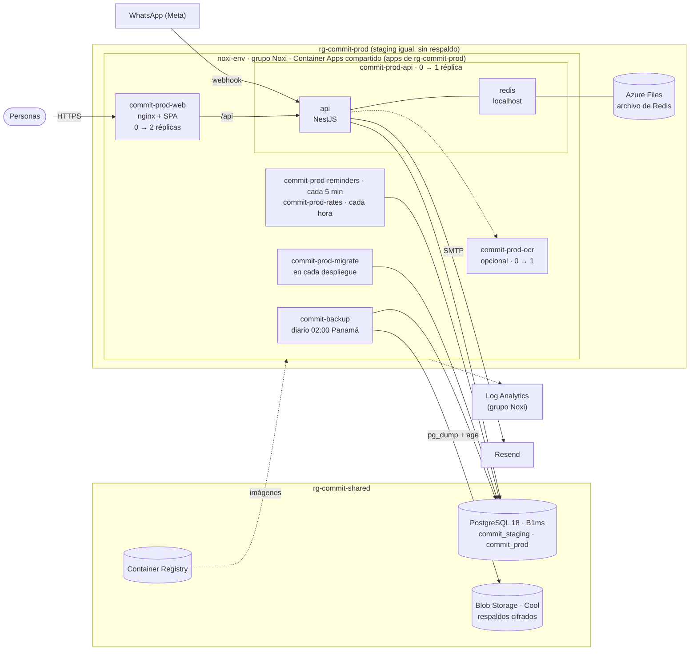
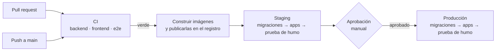

# Despliegue en Azure

Commit corre en **Azure Container Apps** (región **North Central US**) en su versión **económica y bajo demanda**, con dos ambientes: **staging** y **producción**. La infraestructura está como código (Bicep, en `infra/`) y GitHub Actions despliega solo: CI → staging → aprobación → producción.

## Arquitectura



| Recurso | Nombre | Notas |
|---|---|---|
| Grupos | `rg-commit-shared`, `rg-commit-staging`, `rg-commit-prod` (y `Noxi`, ver abajo) | Región `northcentralus` |
| Registro | `commitacr<sufijo>` (Basic) | Compartido; las apps leen con identidad administrada (sin contraseñas) |
| PostgreSQL | `commit-pg-<sufijo>` (B1ms, PG 18) | **Compartido**: una base y un rol por ambiente (`commit_staging`, `commit_prod`); cada rol solo puede entrar a su base. TLS obligatorio, `citext` habilitado |
| Ambiente de Container Apps | `noxi-env` (en el grupo `Noxi`, con su red `noxi-vnet` y sus logs) | **Compartido** por staging y prod. La suscripción (Azure for Students) admite **un solo ambiente** y Azure no permite renombrarlos: se reutiliza el de un proyecto anterior, ya sin otros recursos y etiquetado `app=commit`. Solo consumo, sin costo fijo. Las apps de cada ambiente viven en su grupo y llevan el ambiente en el nombre |
| Frontend | `commit-<env>-web` | nginx; sirve la app y reenvía `/api` al backend. Escala a 0 |
| Backend | `commit-<env>-api` | NestJS + **Redis en la misma réplica** (solo `localhost`). Escala a 0, máximo 1 réplica |
| Archivo de Redis | `commitrs<env><sufijo>` (Azure Files) | Redis guarda una foto cada minuto si hubo cambios y al apagarse: las sesiones sobreviven al escalado a 0 |
| Tareas programadas | `commit-<env>-reminders` (`*/5 * * * *`), `commit-<env>-rates` (`7 * * * *`) | `node dist/cron.js <tarea>`: solo usan PostgreSQL |
| Migraciones | `commit-<env>-migrate` | Se ejecuta en cada despliegue, **antes** de actualizar las apps |
| Respaldo | `commit-backup` (solo en prod) | Diario, respalda las dos bases |
| Respaldos | `commitbak<sufijo>` (Blob, Cool) | Sin acceso por clave (solo identidades de Entra), borrado recuperable 7 días |
| OCR | `commit-<env>-ocr` | Opcional (`enableOcr`), escala a 0 |

## Bajo demanda: qué implica

- **Arranque en frío**: tras unos minutos sin uso, web y api se apagan. El primer pedido los despierta y tarda **unos 10–20 s**. La app es PWA, así que la pantalla carga al instante desde la caché; lo que tarda es la primera consulta.
- **Recordatorios**: se revisan cada 5 minutos (`remindersSchedule`), aunque el backend esté apagado.
- **WhatsApp**: el webhook despierta el backend; si la respuesta tarda, Meta reintenta.
- **Redis**: es la única copia de sesiones y colas, por eso el backend tiene **máximo 1 réplica**. Si se cae sin apagarse bien, se pierde como mucho el último minuto (las personas afectadas vuelven a iniciar sesión). Durante un despliegue conviven brevemente dos réplicas; las sesiones creadas en esos segundos pueden perderse.
- **Escalar**: cuando haya tráfico real, se cambia Redis a Azure Managed Redis y se sube `maxReplicas`.

## Respaldos

| Capa | Qué es | Retención | Costo |
|---|---|---|---|
| Automático de Azure | Restauración a cualquier minuto (PITR) del servidor | 7 días | Gratis hasta 32 GB |
| **Diario externo** | `pg_dump` de cada base, **cifrado con age** y subido a Blob Storage | **30 diarios + 12 mensuales** | Centavos al mes |

- El respaldo se cifra **antes de salir del contenedor** con una clave pública. La clave privada la genera `bootstrap.sh` en `infra/.secrets.backup-age.key`: **guárdala en tu gestor de contraseñas y bórrala de la máquina**. Sin ella, los respaldos no se pueden abrir (ni Azure ni nadie puede leerlos).
- La retención la aplica Blob Storage con una política de ciclo de vida (`daily/` 30 días, `monthly/` 365 días).
- Probar o restaurar:

```bash
# descargar y descifrar (para inspeccionar con pg_restore -l)
infra/scripts/restore.sh 2026-11-27 commit_prod ~/ruta/backup-age.key
# restaurar sobre una base (¡reemplaza su contenido!)
infra/scripts/restore.sh 2026-11-27 commit_prod ~/ruta/backup-age.key "postgresql://…/commit_restore?sslmode=require"
```

Recomendado: probar una restauración una vez al mes en una base aparte.

## Dominios

| Ambiente | App | API |
|---|---|---|
| Producción | https://commit.atheneox.com | https://api-commit.atheneox.com |
| Staging | https://staging-commit.atheneox.com | https://api-staging-commit.atheneox.com |

Certificados administrados por Azure (gratis). `infra/scripts/domains.sh <env>` muestra los registros DNS a crear (un `CNAME` y un `TXT asuid.` por dominio) y, con `--bind`, los vincula cuando el DNS ya propagó.

## Costo estimado (precios públicos de North Central US)

| Recurso | Costo aprox./mes |
|---|---|
| PostgreSQL 18 B1ms compartido + 32 GB | ≈ $16 (gratis 12 meses si la cuenta tiene el beneficio de cuenta nueva) |
| Container Registry Basic | ≈ $5 |
| Container Apps (web, api y tareas, bajo demanda) | ≈ $2–6 (gran parte entra en la cuota gratis mensual) |
| Redis (contenedor) + Azure Files | ≈ $2–4 |
| Respaldos en Blob (Cool) | < $1 |
| Log Analytics (tope de 1 GB/día) | ≈ $0 (5 GB/mes gratis) |
| **Total, ambos ambientes** | **≈ $25–32** |

Container Apps incluye por suscripción y por mes 180 000 vCPU-s, 360 000 GiB-s y 2 millones de pedidos gratis. Verifica con la [calculadora de Azure](https://azure.microsoft.com/pricing/calculator/).

## CI/CD (GitHub Actions)



- `.github/workflows/ci.yml`: backend (typecheck, lint, unitarios y e2e con PostgreSQL 18 y Redis), frontend (íconos, unitarios, build) y e2e en navegador con el stack completo.
- `.github/workflows/deploy.yml`: se dispara cuando el CI pasa en `main` (o a mano). Construye `commit-backend`, `commit-migrate`, `commit-frontend`, `commit-ocr` y `commit-backup`, etiquetadas con el SHA del commit.
- **Autenticación OIDC**: GitHub obtiene un token temporal de Azure; no se guarda ninguna contraseña de Azure. La identidad administrada `commit-github-deploy` (en `rg-commit-shared`, no una aplicación del directorio) solo puede usarse desde este repo en los ambientes `staging` y `production`, y solo tiene permisos sobre los grupos de Commit.

### Configuración en GitHub (Settings → Environments)

Crea los ambientes **`staging`** y **`production`** y en cada uno:

| Tipo | Nombre | Valor |
|---|---|---|
| Variable | `ACR_NAME` | Lo imprime `bootstrap.sh` |
| Secreto | `AZURE_CLIENT_ID`, `AZURE_TENANT_ID`, `AZURE_SUBSCRIPTION_ID` | Los imprime `bootstrap.sh` |
| Secreto | `DB_PASSWORD`, `JWT_SECRET`, `STATUS_TOKEN` | De `infra/.secrets.<env>.env` (distintos por ambiente) |
| Secreto | `SMTP_URL` | `smtps://resend:<API_KEY>@smtp.resend.com:465` |
| Secreto (opcional) | `VAPID_PUBLIC_KEY`, `VAPID_PRIVATE_KEY`, `ANTHROPIC_API_KEY` | Push e IA |
| Solo production | Secreto `PG_ADMIN_PASSWORD` y variable `BACKUP_AGE_RECIPIENT` | Para el respaldo diario (`infra/.secrets.shared.env` y la clave pública que imprime `bootstrap.sh`) |

En **production**, activa **Required reviewers**: cada pase a producción espera tu aprobación.

## Puesta en marcha (una sola vez)

```bash
az login                                   # tu sesión
infra/scripts/bootstrap.sh                 # grupos, compartidos, roles de base, OIDC, secretos, imágenes y primer despliegue
infra/scripts/domains.sh staging           # muestra los registros DNS
infra/scripts/domains.sh staging --bind    # cuando propaguen
infra/scripts/domains.sh prod && infra/scripts/domains.sh prod --bind
```

`bootstrap.sh` es idempotente y compila las primeras imágenes para x86 (`docker buildx --platform linux/amd64`, la Mac es ARM) y las sube al registro; el compilador de ACR no soporta la caché de BuildKit que usan los Dockerfiles. El OCR solo se compila con `WITH_OCR=true`. Para crear los roles de base abre una regla de firewall temporal solo para tu IP y la borra al terminar.

## Detalles de producción

- **IP real**: nginx toma la IP de la persona desde `X-Forwarded-For` y el backend confía en 2 saltos (`TRUST_PROXY=2`): balanceador de Azure y nginx. Los límites de intentos de ingreso son por persona.
- **Llamadas directas a `api-…`**: existen para el webhook de Meta y las verificaciones de salud. Una llamada directa con `X-Forwarded-For` falso podría alterar la IP que ve el límite de intentos; la app usa siempre el camino por nginx.
- **Secretos opcionales**: si una variable opcional (SMTP, IA, WhatsApp, push) no tiene valor, no se declara y la función queda desactivada.
- **`/estado`** en producción requiere `STATUS_TOKEN`.
