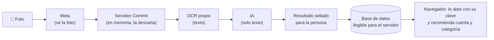

# Facturas por WhatsApp

La persona envía una foto de una factura, recibo o estado de cuenta por WhatsApp (o la sube desde la app). Commit la lee y la deja en **Por revisar** con una recomendación de cuenta y categoría que la persona acepta o cambia.

Es una función **opcional y de pago** (suscripción de **$2 al mes o $20 al año**, hasta 100 comprobantes por mes). El resto de Commit sigue siendo gratis.

## Privacidad: una excepción explícita al conocimiento cero

El resto de la app cifra en el navegador. Esta función no puede hacerlo: la foto llega a Meta y a nuestro servidor. Por eso:

- La persona la activa con **consentimiento explícito** en *Ajustes → WhatsApp*, después de leer qué implica.
- La foto se procesa **en memoria y se descarta**. No se guarda.
- Con el OCR propio activo, **a la IA le llega el texto**, no la foto.
- El resultado se guarda **sellado** con la clave pública de la persona (`crypto_box_seal`): desde ese momento el servidor no puede volver a leerlo.
- Del número de teléfono solo se guarda un **HMAC** (para identificar al remitente), nunca el número.
- La recomendación de cuenta y categoría se calcula **en el navegador**: los nombres de cuentas, categorías y deudas no salen del dispositivo.



## Componentes

| Pieza | Dónde | Qué hace |
|---|---|---|
| Webhook | `backend/src/receipts/receipts.controller.ts` | `GET/POST /api/webhooks/whatsapp`: verificación y mensajes de Meta (firma `X-Hub-Signature-256`) |
| Vinculación | `receipts.service.ts` | Código `COMMIT-123456` de un solo uso (Redis, 10 min) que la persona envía por WhatsApp |
| Procesamiento | `receipts.processor.ts` (cola `receipts`) | Descarga la foto, OCR, extracción con IA, sellado, respuesta por WhatsApp y push |
| Extracción | `extractor.service.ts`, `openrouter.client.ts`, `receipt.schema.ts` | Claude con salida estructurada (Zod), por Anthropic directo u OpenRouter: tipo de documento, comercio, fecha, total, ITBMS, medio de pago, últimos 4 dígitos, categoría genérica, productos |
| OCR | `ocr/` (perfil `ocr`) | RapidOCR (modelos de PaddleOCR sobre ONNX Runtime), `POST /ocr` → texto |
| Bandeja | `frontend/src/app/features/receipts/` | *Por revisar*: abre lo sellado, recomienda (`recommend.ts`) y crea el movimiento o el pago de deuda |

## Cómo se recomienda la cuenta y la categoría

El navegador combina, en este orden:

1. **Últimos 4 dígitos** de la tarjeta → la cuenta de tarjeta que termina igual.
2. **Historial con ese comercio** ("así registraste tus últimas compras en Súper 99").
3. **Medio de pago** (efectivo, débito, crédito, billetera digital).
4. **Categoría genérica** que detectó la IA → la categoría equivalente de Commit.
5. Si es un **pago de préstamo**, la deuda cargada que coincide con el acreedor.

Cada sugerencia muestra sus razones y un nivel de confianza; la persona puede cambiar cualquier campo antes de guardar.

## Configurar Meta (WhatsApp Cloud API)

1. En **Meta for Developers**, crea (o usa) una app de tipo *Business* y agrega el producto **WhatsApp**.
2. Registra el número de Commit y anota el **Phone Number ID**.
3. Genera un **token de acceso permanente** (usuario del sistema del Business Manager) con permisos de WhatsApp.
4. En *Configuración de la app → Básica*, copia el **App Secret**.
5. En *WhatsApp → Configuración → Webhook*:
   - URL de devolución de llamada: `https://<tu-dominio>/api/webhooks/whatsapp`
   - Token de verificación: el mismo valor que pongas en `WHATSAPP_VERIFY_TOKEN`
   - Suscríbete al campo **messages**.
6. Completa el `.env`:

```bash
WHATSAPP_VERIFY_TOKEN=un-valor-largo-y-aleatorio
WHATSAPP_APP_SECRET=...
WHATSAPP_TOKEN=...
WHATSAPP_PHONE_NUMBER_ID=...
WHATSAPP_DISPLAY_NUMBER=5076xxxxxxx      # solo dígitos, para el link wa.me
ANTHROPIC_API_KEY=...                    # o, en su lugar, OPENROUTER_API_KEY=... (ver abajo)
OCR_URL=http://ocr:8000                  # y: docker compose --profile ocr up -d ocr
SUBSCRIPTIONS_ENFORCED=true              # en producción
```

### Con OpenRouter en vez de Anthropic

Con `OPENROUTER_API_KEY` (y sin `ANTHROPIC_API_KEY`, o con `AI_PROVIDER=openrouter`) la extracción va por OpenRouter con `OPENROUTER_MODEL` (por defecto `anthropic/claude-opus-5.5`). Cada pedido exige:

- `zdr: true`: solo proveedores con **retención cero** de datos.
- `data_collection: "deny"`: ninguno que use los datos.
- `require_parameters: true`: solo los que soportan la respuesta estructurada.

Si en ese momento ningún proveedor del modelo cumple, el pedido falla y el comprobante queda con error para reintentar: nunca se envía a uno que guarde datos. La respuesta se valida siempre con el mismo esquema Zod.

Las respuestas de Commit van dentro de la ventana de 24 h que abre el mensaje de la persona. Verifica las tarifas vigentes de Meta para Panamá.

### Reenvíos de Meta

Si Meta no recibe respuesta a tiempo (por ejemplo, mientras el backend despierta), reenvía el mismo mensaje. Cada mensaje se procesa **una sola vez**: su id (`wamid`) se guarda 24 h en Redis.

### En Azure

Variables por ambiente en GitHub (secretos `WHATSAPP_TOKEN`, `WHATSAPP_APP_SECRET`, `WHATSAPP_VERIFY_TOKEN`, `PHONE_HASH_KEY`; variables `WHATSAPP_PHONE_NUMBER_ID`, `WHATSAPP_DISPLAY_NUMBER`). Ver [despliegue-azure.md](despliegue-azure.md).

## Probar sin Meta ni IA (desarrollo)

Fuera de producción existen dos atajos, bloqueados en producción:

| Endpoint | Para qué |
|---|---|
| `POST /api/me/receipts/dev-sample` | Inserta un comprobante ya "extraído" (JSON con el esquema de `receipt.schema.ts`), sellado para la persona |
| `POST /api/me/subscription/dev-activate` | Activa una suscripción de prueba (`MONTHLY` o `YEARLY`) |

El e2e `frontend/e2e/receipts.e2e.ts` usa el primero para recorrer el flujo completo de *Por revisar*.

## Costos aproximados por persona y mes

| Concepto | Estimación |
|---|---|
| WhatsApp | ≈ $0: las respuestas dentro de la ventana de 24 h no tienen costo (verificar tarifa vigente) |
| OCR propio | Infraestructura propia (≈ 0.7 s de CPU por foto) |
| IA, 100 comprobantes | Depende del modelo (`EXTRACTION_MODEL`); con OCR se envía solo texto, que reduce el costo |
| Cobro | Comisión del proveedor de pagos (pendiente de definir) |

El precio de **$2/mes** se eligió porque con $1 la comisión fija del cobro se come casi todo el margen.

## Pendiente

- **Proveedor de pagos**: el botón de suscribirse informa que el cobro todavía no está disponible.
- **Medición de calidad** con facturas reales de Panamá (fotos arrugadas, tickets térmicos, poca luz): precisión del OCR y de la extracción, y costo por comprobante según el modelo.
- **Factura electrónica**: el código QR de la DGI podría dar datos exactos sin IA (por investigar).
