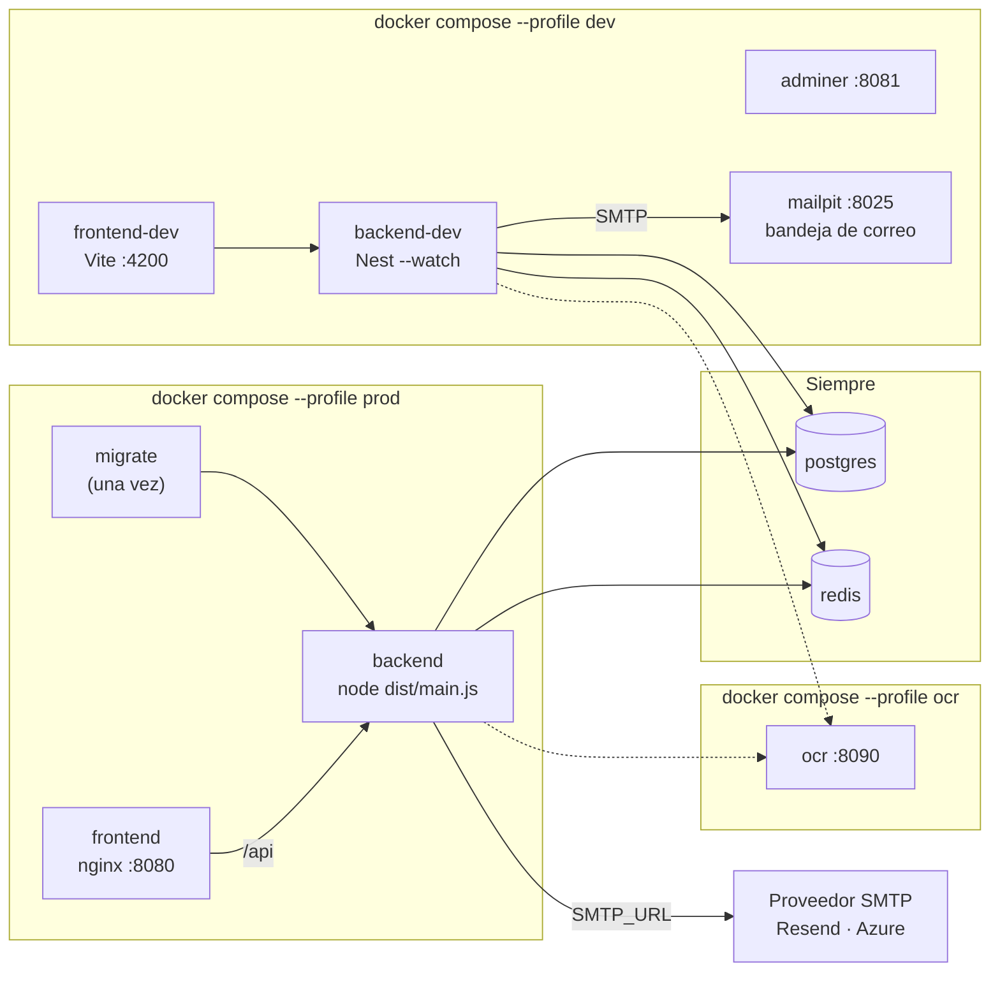

# Operación

Cómo levantar, configurar y mantener Commit.

## Entornos



| | Desarrollo | Producción |
|---|---|---|
| Comando | `docker compose --profile dev up --build` | `docker compose --profile prod up --build -d` |
| URL | http://localhost:4200 | http://localhost:8080 (`FRONTEND_PORT`) |
| Migraciones | Al arrancar `backend-dev` | Servicio `migrate` antes del `backend` |
| Service worker / PWA | No | Sí |
| `/estado` | Abierto | Solo con `STATUS_TOKEN` |
| Correo | Mailpit (http://localhost:8025) | SMTP de `SMTP_URL` |
| Atajos de prueba (`dev-sample`, `dev-activate`) | Sí | Bloqueados |

Pesos de referencia de las imágenes de producción: `frontend` ≈ 115 MB, `backend` ≈ 500 MB, `ocr` ≈ 1 GB.

## Variables de entorno

Se definen en `.env` (ver `.env.example`). La columna **Compose** indica si `docker-compose.yml` ya pasa la variable al backend. Las marcadas con **No** toman su valor por defecto; para cambiarlas hay que agregarlas al bloque `x-backend-env`.

### Base

| Variable | Por defecto | Compose | Descripción |
|---|---|---|---|
| `POSTGRES_USER`, `POSTGRES_PASSWORD`, `POSTGRES_DB` | — | Sí | Credenciales de PostgreSQL (cámbialas en producción) |
| `REDIS_PASSWORD` | — | Sí | Contraseña de Redis |
| `JWT_SECRET` | — (obligatoria, ≥ 32 caracteres) | Sí | Firma de los access tokens. `openssl rand -base64 48` |
| `PUBLIC_URL` | `http://localhost:8080` | Sí | Origen permitido por CORS en producción |
| `FRONTEND_PORT` | `8080` | Sí | Puerto publicado por nginx |
| `AUTH_RATE_LIMIT` | `10` | Solo dev (`200`) | Intentos de login/registro por minuto e IP |
| `TRUST_PROXY` | `1` | **No** | Proxies delante del backend para leer la IP real (compose: nginx = 1; Azure: balanceador + nginx = 2) |

### Correo

| Variable | Por defecto | Compose | Descripción |
|---|---|---|---|
| `SMTP_URL` | vacía (dev: Mailpit) | Sí | Servidor SMTP como URL. Sin ella: en desarrollo se registra en el log; en producción no se envía |
| `SMTP_STARTTLS` | `required` | Sí | `required`, `opportunistic` o `never` (solo Mailpit) |
| `MAIL_FROM` | `Commit <no-reply@commit.local>` | Sí | Remitente (usa un dominio verificado en tu proveedor) |
| `APP_URL` | `http://localhost:4200` | Sí (prod: `PUBLIC_URL`) | Base de los enlaces de los correos |

Proveedores probados por configuración (cualquier SMTP sirve):

```bash
# Resend
SMTP_URL=smtps://resend:<API_KEY>@smtp.resend.com:465
# Azure Communication Services (dominio propio verificado + app de Entra + "SMTP Username")
SMTP_URL=smtp://<SMTP_USERNAME>:<CLIENT_SECRET>@smtp.azurecomm.net:587
```

En desarrollo, **Mailpit** recibe todos los correos sin enviarlos: http://localhost:8025. Los correos de la cuenta (verificación, bienvenida, contraseña, cambios de correo y de clave, ingreso desde un dispositivo nuevo, cuenta eliminada) **nunca incluyen datos financieros**.

### Notificaciones push

| Variable | Compose | Descripción |
|---|---|---|
| `VAPID_PUBLIC_KEY`, `VAPID_PRIVATE_KEY` | Sí | Claves VAPID. Sin ellas solo hay avisos dentro de la app |
| `VAPID_SUBJECT` | Sí | Contacto del operador (`mailto:...`) |

Para generar las claves:

```bash
cd backend && node -e "import('web-push').then(w => console.log(w.generateVAPIDKeys()))"
```

### Facturas por WhatsApp, OCR e IA

| Variable | Por defecto | Compose | Descripción |
|---|---|---|---|
| `WHATSAPP_VERIFY_TOKEN`, `WHATSAPP_APP_SECRET`, `WHATSAPP_TOKEN`, `WHATSAPP_PHONE_NUMBER_ID` | vacías | Sí | Credenciales de Meta (ver [facturas-whatsapp.md](facturas-whatsapp.md)) |
| `WHATSAPP_DISPLAY_NUMBER` | vacía | Sí | Número público, solo dígitos (link `wa.me`) |
| `ANTHROPIC_API_KEY` | vacía | Sí | Extracción con IA |
| `OCR_URL` | vacía | Sí | `http://ocr:8000` con el perfil `ocr` levantado |
| `SUBSCRIPTIONS_ENFORCED` | `false` | Sí | `true` en producción para exigir suscripción |
| `EXTRACTION_MODEL` | `claude-opus-5-5` | Sí | Modelo de extracción |
| `RECEIPTS_MONTHLY_LIMIT` | `100` | Sí | Comprobantes por persona y mes |
| `PHONE_HASH_KEY` | derivada de `JWT_SECRET` | Sí | Clave del HMAC del número. Cambiarla desvincula los números ya vinculados |
| `WHATSAPP_GRAPH_VERSION` | `v23.0` | Sí | Versión de la Graph API de Meta |

### Operación interna

| Variable | Por defecto | Compose | Descripción |
|---|---|---|---|
| `STATUS_TOKEN` | vacía | Sí | Token de operador para `/estado` en producción (vacío = inaccesible) |
| `RATES_REFRESH` | `true` | **No** | Actualizar cotizaciones cada hora |
| `REMINDERS_JOB` | `true` | **No** | Disparar recordatorios cada minuto |
| `QUEUE_PREFIX` | `bull` | **No** | Prefijo de las colas en Redis (los tests usan uno propio por worker) |

## Migraciones

```bash
# crear una migración (en desarrollo, contra la base del compose)
docker compose exec backend-dev pnpm prisma migrate dev --create-only --name descripcion
# aplicar
docker compose exec backend-dev pnpm prisma migrate deploy
```

Toda tabla nueva con `revision` necesita el trigger `set_sync_revision` en su migración (ver `backend/AGENTS.md`).

## Estado de la infraestructura (`/estado`)

La página `/estado` dibuja la infraestructura y verifica en vivo, cada 10 s: PostgreSQL (versión, migraciones, tamaño), Redis, colas de BullMQ, OCR y cotizaciones recientes. WhatsApp, IA y Web Push se muestran como *configurados* o *desactivados*, sin hacerles llamadas.

- **Desarrollo**: abierta, con un link en el pie.
- **Producción**: define `STATUS_TOKEN` y entra a `/estado` con ese token. Sin token válido, `GET /api/status` responde **404**.
- No muestra datos de usuarios.

## Mantener contenidos

| Contenido | Archivo | Cómo actualizar |
|---|---|---|
| Tasas de referencia de bancos (hipotecas y tarjetas) | `frontend/src/app/features/tools/bank-rates.ts` | Revisa las fuentes enlazadas (tarifario de la Superintendencia de Bancos, estudio de Acodeco), cambia valores y fuentes, y actualiza `CHECKED_AT` |
| Artículos de *Aprende* | `frontend/src/app/features/learn/articles/*.ts` | Cada artículo tiene nivel, tema y bloques; el test `articles.spec.ts` exige 3 niveles por tema y enlaces válidos |
| "Leer más" desde consejos y Plan mágico | `frontend/src/app/features/learn/links.ts` | Mapa consejo → artículo |
| Monedas del catálogo | Migraciones `seed_currencies` y `panama_currencies` | Agregar con una migración nueva (`ON CONFLICT DO NOTHING`) |
| Textos de la app | `frontend/public/i18n/es.json` | Español de Panamá, trato de **tú** |
| Íconos (fuente recortada) | `frontend/scripts/icons/` | Ver abajo |

### Íconos

La fuente Material Symbols está **recortada** a los íconos que usa la app (≈ 147 kB en vez de 3.8 MB). Al agregar un ícono nuevo:

```bash
cd frontend
pip install fonttools brotli   # una sola vez
pnpm icons:subset              # detecta los íconos en uso y regenera public/fonts/material-symbols-outlined-subset.woff2
```

Si te olvidas, `pnpm build` y `pnpm test` fallan con `pnpm icons:check`, indicando qué ícono falta y dónde se usa. El e2e `e2e/icons.e2e.ts` recorre las pantallas y verifica que ningún ícono se vea como texto.

## Seguridad operativa

- Cambia todas las contraseñas de `.env.example` antes de producción y no subas `.env` al repositorio.
- Sirve la app solo por **HTTPS** (detrás de un proxy o balanceador con TLS).
- Cifra el disco del servidor: es una segunda capa sobre el cifrado de la app.
- Respalda PostgreSQL de forma periódica (por ejemplo, `pg_dump` programado). Los respaldos contienen los datos cifrados: sin las claves de cada persona no se pueden leer.
- Rota `STATUS_TOKEN`, `WHATSAPP_*` y `ANTHROPIC_API_KEY` si sospechas una filtración.

## Tests

```bash
cd backend && pnpm typecheck && pnpm lint && pnpm test && pnpm test:e2e
cd frontend && pnpm ng test && pnpm e2e    # con el stack de desarrollo levantado
```

Los e2e del backend usan Postgres y Redis del compose, con colas aisladas por worker. Los e2e del frontend corren contra http://localhost:4200.
